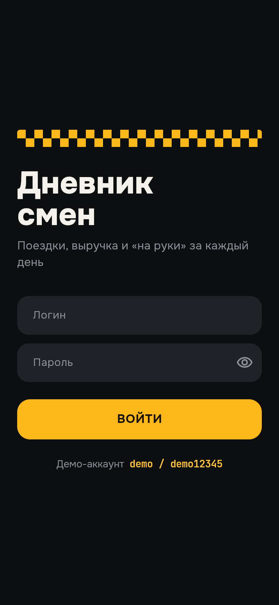
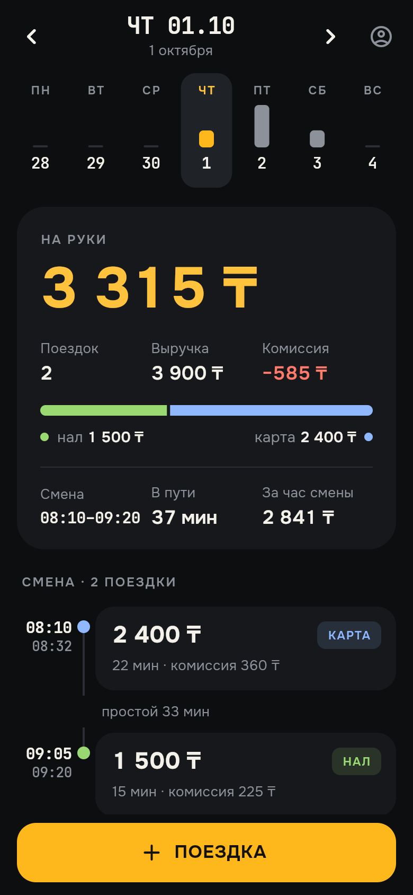
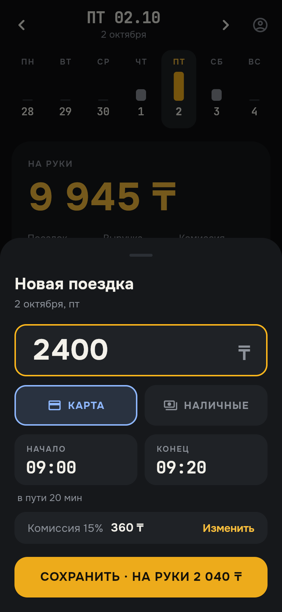
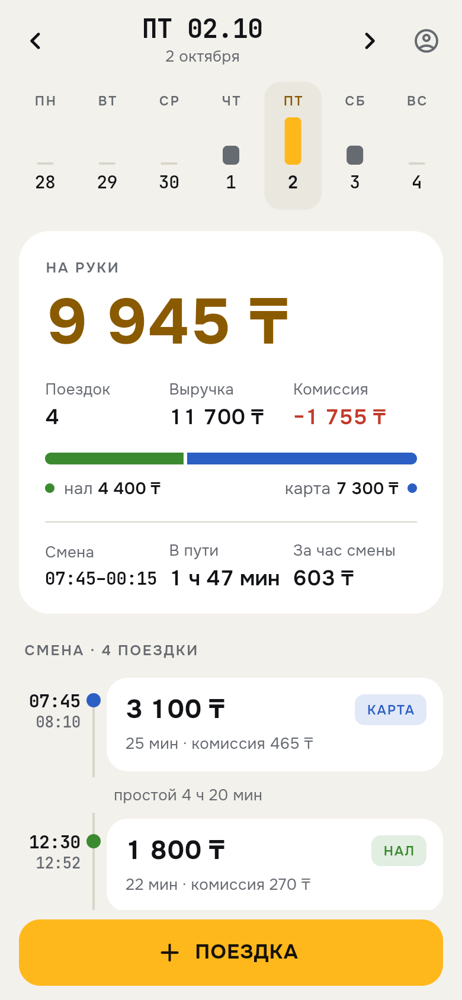
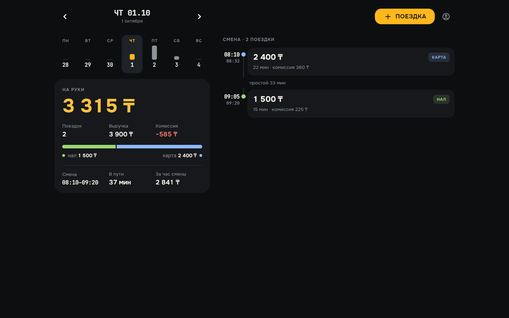
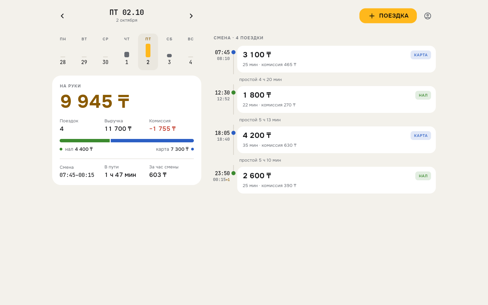

# Дневник смен водителя

[](https://github.com/rake1713/rake-diary/actions/workflows/ci.yml)

Приложение для водителя такси: поездки за день, выручка, комиссия и сколько остаётся на руки.

Бэкенд на FastAPI, клиент на Flutter (Android, iOS и веб из одного кода). Собранный веб-клиент раздаёт тот же сервер, поэтому сайт и API работают на одном домене.

| | | | |
|---|---|---|---|
|  |  |  |  |

Веб-версия на широком экране:





Демо-аккаунты: `demo / demo12345` (с поездками из `data/trips.json`) и `demo2 / demo2pass` (пустой).

## Запуск

Требования: [uv](https://docs.astral.sh/uv/), Python 3.12, Flutter 3.47.

```bash
./run.sh          # сервер, сайт и приложение на подключённом телефоне
./run.sh --sim    # приложение в симуляторе iOS / эмуляторе Android
./run.sh --web    # только сервер и сайт
```

`run.sh` пересобирает веб, если менялся код Flutter, поднимает сервер на http://localhost:8000 и запускает приложение на подключённом телефоне с IP этого компьютера в качестве адреса API. `Ctrl+C` останавливает всё.

Без скрипта:

```bash
cd app && flutter build web --no-web-resources-cdn && cd ..
cd backend && uv sync && uv run diary
```

При первом запуске сервер создаёт `backend/diary.db` и загружает поездки из `data/trips.json`, повторный запуск ничего не дублирует.

Cookie сессии помечена `Secure`. Safari не принимает такие cookie на http://localhost, поэтому для него локальный запуск такой: `DIARY_COOKIE_SECURE=false uv run diary`.

Swagger в режиме разработки: http://localhost:8000/docs.

Приложение без скрипта:

```bash
cd app
flutter run --dart-define=API_BASE_URL=http://10.0.2.2:8000   # эмулятор Android
flutter run --dart-define=API_BASE_URL=http://localhost:8000  # симулятор iOS
```

Тесты:

```bash
cd backend && uv run pytest && uv run ruff check .
cd app && flutter analyze && flutter test
```

## API

Всё, кроме `/api/health` и `/api/auth/login`, требует входа.

| Метод | Путь | |
|---|---|---|
| `POST` | `/api/auth/login` | веб получает cookie, мобильный клиент (`X-Client: mobile`) получает токен |
| `POST` | `/api/auth/logout` | удаляет сессию на сервере |
| `GET` | `/api/auth/me` | текущий водитель и его часовой пояс |
| `GET` | `/api/days` | дни с поездками и сумма на руки за каждый; `?from=&to=` для периода |
| `GET` | `/api/days/2026-10-01` | сводка и поездки за день |
| `POST` | `/api/trips` | 201 создана, 200 уже была, 409 тот же id с другими данными, 422 ошибка проверки |

```bash
TOKEN=$(curl -s -X POST localhost:8000/api/auth/login -H 'X-Client: mobile' \
  -H 'Content-Type: application/json' -d '{"login":"demo","password":"demo12345"}' | jq -r .token)

curl -s localhost:8000/api/days/2026-10-01 -H "Authorization: Bearer $TOKEN"
# {"date":"2026-10-01","utc_offset":"+05:00",
#  "summary":{"trips":2,"revenue":3900,"commission":585,"net":3315,"cash":1500,"card":2400}, "trips":[...]}
```

## Как устроено

Деньги хранятся и считаются в целых тенге, float нигде не используется.

День считается по местному времени водителя (UTC+5, настройка `DIARY_UTC_OFFSET`), а не по UTC. Поездка в 00:40 по Алматы приходится на 19:40 UTC предыдущего дня, но попадает в свой день. Поездка через полночь относится к дню начала. В базе время хранится в UTC.

Дубли отсекает сама база: `PRIMARY KEY (driver_id, id)` и `INSERT … ON CONFLICT DO NOTHING`, без схемы «проверил, потом вставил». Поэтому одновременные одинаковые запросы тоже дают одну запись. Повтор с теми же данными возвращает 200 и сохранённую поездку, тот же id с другими данными возвращает 409. Время сравнивается как момент: `08:10+05:00` и `03:10Z` считаются одной поездкой. Клиент создаёт id при открытии формы, и повторное нажатие «Сохранить» после обрыва связи не создаёт вторую поездку.

Проверка данных строгая, те же условия продублированы в `CHECK` базы:
- сумма — целое число больше нуля, строка `"2000"` и `2000.5` не принимаются;
- окончание позже начала, поездка не длиннее суток;
- комиссия от нуля до суммы поездки;
- время только с часовым поясом;
- лишние поля запрещены.

## Безопасность

- Сессии серверные, в базе хранится только SHA-256 токена. Выход и истечение (12 часов) закрывают доступ сразу.
- Веб получает сессию в cookie `__Host-` с `HttpOnly`, `Secure`, `SameSite=Strict`. Изменяющие запросы требуют заголовок `X-Requested-With`, `Origin` сверяется с хостом, CORS выключен.
- Мобильный клиент хранит токен в Keychain / Keystore, в релизной сборке разрешён только https.
- Пароли хешируются argon2id. После 5 неудачных попыток за 15 минут вход блокируется по IP и по логину. Ответ одинаковый для неверного логина и неверного пароля.
- Каждый запрос видит только данные своего водителя. id поездки уникален в пределах водителя, поэтому по ответу нельзя узнать о чужих поездках.
- Тело запроса ограничено 16 КБ, в том числе при chunked-передаче, плюс 120 запросов в минуту на IP.
- Только параметризованный SQL. Наружу не уходят ни стектрейсы, ни введённые значения.
- CSP, HSTS, `nosniff`, запрет встраивания во фрейм. В проде Swagger выключен. Контейнер работает read-only и не от root.

Всё это покрыто тестами в `backend/tests/test_security.py`. В CI работают `pip-audit`, `gitleaks` и Dependabot.

Счётчики лимитов хранятся в памяти процесса — сервер запускается в одном экземпляре.

## Интерфейс

Тёмная тема основная, под ночные смены; светлая включается по настройке системы. На телефоне одна колонка и большая кнопка внизу. На широком экране (от 900 px) день и неделя слева, лента смены справа, кнопка добавления в шапке.

Крупнее всего на экране сумма на руки, рядом выручка, комиссия и соотношение наличных и карты. Полоса недели показывает заработок по дням, дни переключаются свайпом. В ленте смены видны поездки, простои между ними, время в пути и заработок за час.

В форме новой поездки для сегодняшнего дня время подставляется по текущему, комиссия считается по ставке 15% и правится вручную.

Шрифты Onest и JetBrains Mono (OFL) встроены в приложение. Иконку рисует скрипт `app/tool/make_icon.py`.

## Деплой

`Dockerfile` собирает Flutter web и упаковывает его вместе с FastAPI в один образ. Перед ним стоит Caddy, который получает сертификат Let's Encrypt.

```bash
git clone https://github.com/rake1713/rake-diary.git && cd rake-diary/deploy
cp .env.example .env
docker compose up -d --build
```

## Структура

```
backend/src/diary/   API: маршруты, сводка, поездки, безопасность, валидация
backend/tests/       pytest
app/lib/             Flutter: клиент API, экраны, виджеты, тема
app/test/            тесты Flutter
data/trips.json      исходные поездки
deploy/              docker compose и Caddy
```
